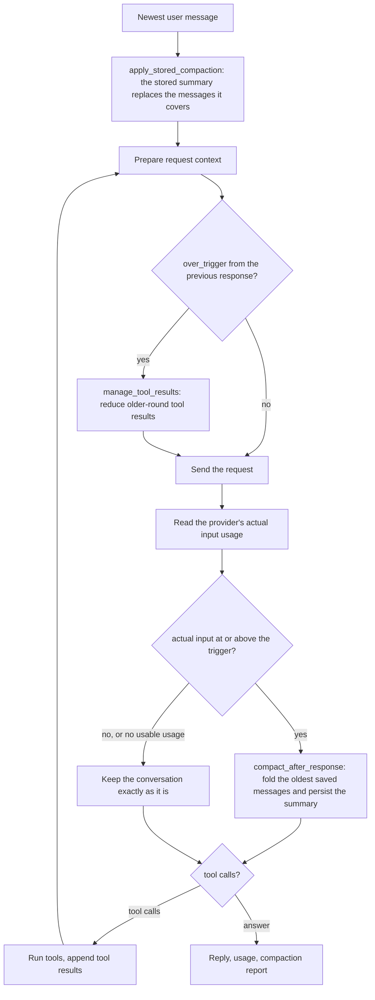

# Architecture

Token Harbor Chat is a single-page chat front end served by a small FastAPI backend.
The backend answers one message at a time and may call two tools while doing so.

The defining rule of this version: **the agent runtime does no local token counting.**
It never estimates the size of a request. Conversation compaction is triggered only by
the provider's *actual* reported input usage, and every size the UI shows is either
that reported usage or a configured value.

## Files and responsibilities

| Path | Responsibility |
| --- | --- |
| `app.py` | HTTP layer only: the `ChatRequest` model, the static mount, the `/`, `/api/config` and `/api/chat` routes, the 413/502 mapping, and `uvicorn` startup. |
| `config.py` | `.env` loading, the environment variable names and defaults, `get_settings()`, `create_client()`, and the safe error messages (`friendly_error`). |
| `agent/chat.py` | `SYSTEM_PROMPT`, the tool registry, `execute_tool_call()`, browser history filtering (`keep_history`) and `run_chat_with_tools()`, the model request loop. |
| `agent/compaction.py` | Post-response conversation compaction and pre-request tool-result management: folding the oldest saved messages into the persistent summary when the provider's actual input crosses the trigger, and reducing older tool results when that same reported number says the request was large. |
| `agent/tool_result_manager.py` | Tool-result safety and reduction: classifying results from their own metadata, replacing a result with a clearly marked managed representation, keeping the raw text in a bounded in-memory store, and reading it back again. |
| `agent/context_priority.py` | Deterministic priority scoring for the items of a prepared request, so reduction can explain why one item goes before another. It never counts tokens. |
| `agent/token_usage.py` | Reading the usage block of a completion, aggregating it across calls, and keeping "not reported" different from `0`. |
| `agent/context_budget.py` | The configured context budget (documented capacity, for the 413 message) and turning a provider context-limit error into the readable 413 answer. |
| `tools/write_file.py` | The `write_file` tool: workspace-only paths, suffix and size rules, no overwrite without `overwrite=true`, atomic write. |
| `tools/web_search.py` | The `web_search` tool: Tavily search, result truncation, and results marked as untrusted data. |
| `static/` | The front end (`index.html`, `app.css`, `js/app.js`, `js/store.js`, `js/icons.js`). It renders the provider's usage, the compaction decision and the analytics panel from the JSON the API returns. |
| `docs/` | This file, the context-budget deep dive (`CONTEXT_BUDGET.md`) and the earlier backend report. |
| `INITIAL_SETUP.md` | The complete setup guide for a new machine: prerequisites, virtual environment, dependencies, `.env` keys, how to run the app, and troubleshooting. |

Import order: `config.py` imports nothing from the project; `agent/context_budget.py`
imports `config`; `agent/context_priority.py` imports nothing from the project;
`agent/tool_result_manager.py` imports `config` and the token-usage reader;
`agent/compaction.py` imports `config`, the token-usage reader and those two modules;
`agent/chat.py` imports the agent modules and the tools; `app.py` imports the rest.
There is no tokenizer module any more: token estimation was removed entirely, so no
part of the runtime can count tokens.

## One message, end to end

1. The browser posts `{message, history, compaction}` to `/api/chat`. `history` is a
   list of `{role, content, id}` objects the browser kept, and `compaction` is that
   conversation's stored summary metadata (or nothing, for a conversation that has
   never been compacted).
2. `chat()` in `app.py` reads the settings and builds the client. The model comes from
   `.env` (`MODEL_ID`) and is never taken from the request body.
3. `keep_history()` keeps at most the newest 40 entries and only plain `user` /
   `assistant` pairs. A message id travels as internal `_id` bookkeeping and is
   stripped again before the model call. The message list is then the system prompt,
   that filtered history, and the trimmed newest user message.
4. `run_chat_with_tools()` first applies the conversation's stored compaction (the
   summary replaces the messages it covers, with no measurement), then runs the loop
   below and returns `(reply, steps)`.
5. The response is `{reply, model}` plus `steps` when a tool ran, `usage` for the
   provider-reported counts, `context` for the compaction decision and tool-result
   report, and `compaction` when the stored summary changed. A request the provider
   refuses as too long becomes `413`; a provider or tool failure becomes `502` with a
   message from `friendly_error()` and the raw error only in the console.

## The model request loop

`run_chat_with_tools()` alternates between sending a request, reading the provider's
reported usage, and running the tools the model asks for:

1. `apply_stored_compaction()` (once, before the loop) rebuilds the request around the
   stored summary.
2. Before each call, `manage_tool_results()` runs **only** when `over_trigger` is true
   - that is, when the *previous* response's actual input was at or above the
   compaction trigger. It replaces older-round tool results, one at a time, never the
   newest round.
3. The model is called with `tools` and `tool_choice="auto"` on the first rounds. If
   the provider rejects the tool schemas with a `BadRequestError`, the record for that
   attempt is dropped, a `tools / unsupported` step is added, and the call is retried
   without tools. If the same error reports a context-limit problem, it is recorded as a
   provider-reported context failure and the loop tries a **bounded** recovery: while no
   tool has run yet (`tool_executions == 0`) and at most once (`MAX_CONTEXT_RETRIES`), it
   folds the older saved messages with `retry_compaction()` and re-sends. A retry never
   repeats a side effect and can never loop; when folding is impossible, or the retry was
   already used, the turn stops with the readable `413` and the conversation is left
   untouched.
4. The usage the provider reported is stored on that call's record.
5. `compact_after_response()` compares that actual input with the compaction trigger.
   At or above it, the oldest saved messages are folded into the stored summary and
   the resulting messages are what the rest of the turn uses; below it, or when the
   response reported no usable usage, the conversation is left exactly as it was. The
   same comparison sets `over_trigger` for the next iteration.
6. If the model answered with text, the loop ends and returns the reply.
7. If the model asked for tools, an assistant message carrying those tool calls is
   appended, each tool runs, and one `tool` message per result is appended. Up to
   three calls per round are executed; further calls in the same round are refused
   with "Too many tool calls in one round." so a single round cannot fan out.
8. After three tool rounds the tools are dropped and a final user message asks the
   model to answer with what it already has, so the turn cannot loop forever.

## Token usage (the provider's measurement)

`agent/token_usage.py` reads the usage block of each completion into five fields:
`input_tokens`, `output_tokens`, `total_tokens`, `cached_input_tokens` and
`reasoning_tokens`. Rules that keep the numbers honest:

* A field the provider left out stays `None`, which means "not reported" and is never
  confused with a real `0`.
* Booleans, negative numbers and non-integers are treated as not reported.
* The field names are normalised: input comes from `prompt_tokens` or `input_tokens`,
  output from `completion_tokens` or `output_tokens`.
* `cached_input_tokens` is a subset of the provider's input count, never something
  added to it.
* `summarize_usage()` adds each field across the calls that reported it.
* `total_tokens` prefers the provider's own total; `input + output` is used only when
  every call reported both parts, and then `derived_total` is true.

The reported `input_tokens` of a response is the only value the runtime uses to decide
a post-response compaction, and the only value that decides whether a tool-result pass
runs.

Summary-generation calls (compaction and tool-result condensing) are internal management
requests. Their usage, when the provider reports it, is aggregated separately as
`management_usage` and shown in its own section: it is never added to the conversation's
usage and never drives a compaction decision.


## Context budget and the compaction threshold

`agent/context_budget.py` reads a documented, configured budget:

```
context_window_tokens          # CONTEXT_WINDOW_TOKENS, default 8192
max_output_tokens              # MAX_OUTPUT_TOKENS, default 1024
context_safety_margin_tokens   # CONTEXT_SAFETY_MARGIN_TOKENS, default 512

max_input_budget_tokens        = window - max_output - margin
```

The window is a *configured* value, not a provider fact, and it is no longer the basis
of the compaction threshold. The threshold is an absolute provider **actual** input
count read straight from configuration:

```
ACTUAL_INPUT_TOKEN_THRESHOLD   # default 4659
```

A completed response whose reported input is at or above that number is compacted. The
default 4659 is the previously derived value (70% of 8192 - 1024 - 512), now expressed
directly in actual tokens so nothing about it depends on a budget this app measured.

**There is no local preflight.** The app cannot know whether a request fits the
provider's limit until the provider reads it, so the budget settings do not guarantee
that an unsent request fits. When the provider refuses a request as too long,
`is_context_limit_error()` recognises it, the attempt is recorded as a provider-reported
context failure, `retry_compaction()` may fold history for one bounded re-send, and
`context_limit_message()` explains the `413` when recovery is impossible. History is
never destroyed or silently truncated.

## Context management (compaction, tool results, priority)

Context management has two decision points and one application step, and it never
rewrites the stored conversation:

```
Stored conversation (the browser)      Request context (what is sent)
---------------------------------      ------------------------------
every message, unchanged               system prompt + stored summary
compaction.summary                     saved messages after the boundary
compaction.last_compacted_message_id   newest user message, this turn, tool results
```

* **Applying the stored summary** (`apply_stored_compaction()`): at the start of a turn
  the stored summary replaces everything up to `last_compacted_message_id`. No decision
  and no measurement are involved; this is what makes compaction persist.
* **Conversation compaction** (`compact_after_response()` → `compact_request()`): after
  every response, when the provider's actual input is at or above the trigger. How much
  is folded is decided structurally - `groups_to_fold()` keeps roughly
  `COMPACTION_TARGET_RATIO` of the saved-message groups verbatim (never fewer than
  `MIN_RECENT_HISTORY_MESSAGES`, never all of them) and folds the rest - because
  without local estimates there is no size to measure against.
* **Tool-result management** (`manage_tool_results()`): before a request, when the same
  reported number was over the trigger. It walks the request in priority order and
  reduces older-round results one by one.

### Conversation compaction

* **What is eligible**: only the saved-history block. The system prompt, the newest user
  message and this turn's tool messages are never folded. Saved messages are grouped so
  an assistant tool-call message and the tool results answering it are one group, and a
  group is always folded whole.
* **How**: one dedicated model request with **no tools**, receiving the previous summary
  plus the turns being folded in. The reply is validated before it replaces anything,
  and the summary request is never itself compacted.
* **Where it is stored**: `compaction` travels with the conversation. The browser stores
  it, sends it back with the next request, and the server sanitises it again on arrival.
  `last_compacted_message_id` marks the newest folded message, so a later compaction
  only summarises what came after it.
* **Failure**: a summary request that fails, times out or returns something unusable
  leaves the previous summary, the stored conversation and the request exactly as they
  were, and records the reason.


### Tool-result management (`agent/tool_result_manager.py`)

Tool results are handled separately from conversation history, because they are the
part of a request that grows fastest and because a tool message can never be removed:
its `tool_call_id` must keep matching the assistant message that asked for it.
Management therefore **replaces content, never structure**.

| Piece | Behaviour |
| --- | --- |
| Classification | Metadata only: `critical` when the result reports a failure (`ok: false` or an `error`), `normal` otherwise. There is no token-based size class; eligibility comes from a byte threshold. |
| Large-result threshold | A result is eligible to be reduced only at or above `TOOL_RESULT_LARGE_BYTES` (default 4096 UTF-8 bytes). A smaller result is kept verbatim. This is a direct byte measurement, not a token estimate. |
| Managed representation | A marked block: `[managed tool result]`, the tool name, the tool's status, the original character count, the retained result id, the mode, and a closing line that says it is data. |
| Summary | One dedicated request with **no tools**. Validation is 40-4,000 characters and not a repeat of the raw output. If the provider reports usage for it, that usage is recorded in the separate Summary Generation Usage section, never added to the conversation's usage. |
| Deterministic trim | Used for `critical` results: the tool's reported fields and its error text are kept verbatim, plus the first 600 and last 200 characters of the body. |
| Retention | Raw content is kept in a bounded in-memory store (`TOOL_RESULT_STORE_MAX_BYTES`, default 5 MiB) keyed by `tool_call_id`, oldest evicted first. |
| Retrieval | `retrieve_raw(result_id)` returns the original. Before anything is replaced, the retained copy is read back, and a result whose raw copy cannot be recovered is left exactly as the tool returned it. |
| Smaller than the original | A replacement is kept only when the managed text is shorter than the raw text - a direct byte comparison, never a token estimate. |
| Integrity | A result that is already managed is never summarised again; a result with no matching tool call is never touched; the newest round is left verbatim. |

### Priority scoring (`agent/context_priority.py`)

Reduction needs an order that is explainable, so priorities are additive: a base weight
per kind of item (system 1000, unmatched tool message 900, newest user message 900,
active-turn user 500, active-turn assistant 400, newest-round tool result 350, saved
user 300, saved assistant 200, older tool result 150), then modifiers - `critical`
result +200, already managed -50, shares a term with the current request +150 - and an
age decay of -2 per message away from the newest, capped at -200. There is deliberately
no size modifier: "large" is not a fact the runtime can know. Ties break towards the
older message, and every score carries the reasons that produced it.

### The lifecycle in one picture



### Failure behaviour

* A summary request that fails leaves the previous summary, the stored conversation and
  the request exactly as they were, and records the reason.
* A tool result whose raw copy could not be retained (or could not be read back) stays
  in full.
* A managed representation that would not actually be smaller is discarded.
* A response that reported no usable usage never triggers compaction: the conversation
  is preserved and the missing usage is recorded.
* A provider context-limit error is recorded as a provider-reported context failure; the
  loop may fold history for one bounded re-send (only while no tool has run), and when it
  cannot recover it ends the turn with a readable 413 and changes nothing.
* Nothing in this path can leak secrets: only counts, ids, reasons and character
  lengths are logged.

## Safety rules and where they live

* Secrets: `.env` is read in `config.py` and never leaves the server. The system prompt
  forbids repeating them, `/api/config` returns only `{"ok": true}`, and error messages
  come from a fixed list in `friendly_error()`.
* Files: `tools/write_file.py` allows only workspace-relative paths inside the
  workspace, only `.txt/.md/.json/.csv` up to 200 KB, refuses to replace an existing
  file without `overwrite=true`, and can never rename, move or delete.
* Untrusted web content: `tools/web_search.py` marks results as untrusted data, and the
  system prompt says to ignore instructions found inside them.
* The model cannot pick itself: the configured model in `.env` is used for every request.
* A tool failure is reported to the model as data (`ok: false` plus a reason), and the
  system prompt requires the model to tell the user instead of inventing a success.

