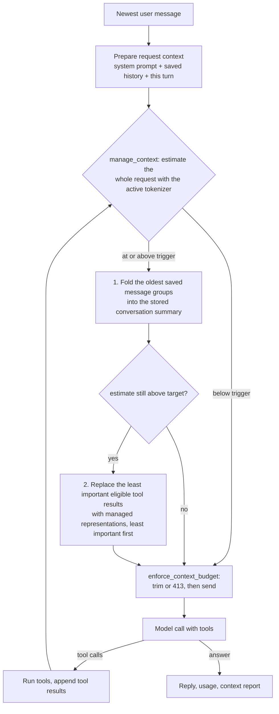

# Architecture

Token Harbor Chat is a single-page chat front end served by a small FastAPI
backend. The backend answers one message at a time, may call two tools while doing
so, and reports both the provider's real token usage and the app's own estimates of
the context it sent.

## Files and responsibilities

| Path | Responsibility |
| --- | --- |
| `app.py` | HTTP layer only: the `ChatRequest` model, the static mount, the `/`, `/api/config` and `/api/chat` routes, the 413/502 mapping, and `uvicorn` startup. |
| `config.py` | `.env` loading, the environment variable names and defaults, `get_settings()`, `create_client()`, and the safe error messages (`friendly_error`). |
| `agent/chat.py` | `SYSTEM_PROMPT`, the tool registry, `execute_tool_call()`, browser history filtering (`keep_history`) and `run_chat_with_tools()`, the model request loop. |
| `agent/tokenizer.py` | Choosing a tokenizer (the verified DeepSeek V4.1 tokenizer through Hugging Face, tiktoken, or the character heuristic), counting text, and describing how far the count can be trusted. |
| `agent/compaction.py` | Summary-based context compaction and the adaptive management pass: deciding when older saved messages should be folded into a persistent summary, generating and validating that summary, and rebuilding the request context around it. |
| `agent/tool_result_manager.py` | Tool-result management: classifying results, replacing expensive ones with a clearly marked managed representation, retaining the raw content in a bounded in-memory store, and retrieving it again. |
| `agent/context_priority.py` | Deterministic priority scoring for the items of a prepared request, so context management reduces the least important thing first and can explain why. |
| `agent/token_usage.py` | Reading the usage block of a completion, aggregating it across calls, and keeping "not reported" different from `0`. |
| `agent/context_budget.py` | Estimating a prepared request, comparing it with the configured budget, trimming history safely, and building the per-call and per-answer context records. |
| `tools/write_file.py` | The `write_file` tool: workspace-only paths, suffix and size rules, no overwrite without `overwrite=true`, atomic write. |
| `tools/web_search.py` | The `web_search` tool: Tavily search, result truncation, and results marked as untrusted data. |
| `static/` | The front end (`index.html`, `app.css`, `js/app.js`, `js/store.js`, `js/icons.js`). It renders usage, estimates and the analytics panel from the JSON the API returns. |
| `docs/` | This file, the context-budget deep dive (`CONTEXT_BUDGET.md`) and the earlier backend report. |
| `INITIAL_SETUP.md` | The complete setup guide for a new machine: prerequisites, virtual environment, dependencies, the one-time DeepSeek V4.1 tokenizer download, `.env` keys, how to run the app, and troubleshooting. |

`config.py` imports nothing from the project; `agent/tokenizer.py` imports
`config`; `agent/context_budget.py` imports both; `agent/context_priority.py`
imports nothing from the project at all; `agent/tool_result_manager.py` imports
`config` and `agent/context_budget`; `agent/compaction.py` imports `config`, the
budget, the tokenizer and both new modules; `agent/chat.py` imports the agent
modules and the tools; `app.py` imports the rest. That order has no cycles, so any
module can be read or tested on its own.

## One message, end to end

1. The browser posts `{message, history, compaction}` to `/api/chat`. `history` is
   a list of `{role, content, id}` objects the browser kept on its side, and
   `compaction` is that conversation's stored summary metadata (or nothing, for a
   conversation that has never been compacted).
2. `chat()` in `app.py` reads the settings and builds the client. The model comes
   from `.env` (`MODEL_ID`) and is never taken from the request body, so the
   browser cannot choose the model.
3. `keep_history()` keeps at most the newest 40 entries, and only plain
   `user`/`assistant` pairs. Anything else the browser sends never reaches the
   model; a message id is kept aside as `_id` bookkeeping and stripped again before
   the model call. The message list is then the system prompt, that filtered
   history, and the trimmed newest user message.
4. `run_chat_with_tools()` runs the loop described below, and returns
   `(reply, steps)`. When the request has grown past the compaction trigger, the
   older saved messages are first folded into the conversation's summary, which is
   returned so the browser can store it.
5. The response is `{reply, model}` plus `steps` when a tool ran, `usage` for the
   provider-reported counts, `context` for the pre-call estimates and the active
   budget, and `compaction` when the stored summary changed. A request that cannot
   fit the budget is refused locally with `413` and the same `context` summary
   (and `compaction`, when a summary was produced first); a provider or tool
   failure becomes `502` with a message from `friendly_error()` and the raw error
   only in the console.

## The model request loop

`run_chat_with_tools()` alternates between measuring, calling the model, and
running the tools it asks for:

1. Before every call, `manage_context()` measures the prepared request and, above
   the compaction trigger, reduces it in a fixed order: older saved messages are
   folded into the conversation summary (never re-summarising what an earlier pass
   already covered), then the least important eligible tool results are replaced by
   their managed representations. Below the trigger nothing runs at all, so an
   ordinary turn pays for nothing, and a request that is still too large afterwards
   is left to the budget as before.
2. `enforce_context_budget()` prepares the exact message list for the next call
   (system prompt, kept history, this turn so far) plus the tool schemas when
   tools are still allowed.
3. If the prepared request is still too large, `ContextBudgetExceeded` is raised
   with a readable reason and the rejected call's record; `app.py` turns that into
   the `413` answer.
4. Otherwise the model is called, with `tools` and `tool_choice="auto"` on the
   first rounds. If the provider rejects tools with a `BadRequestError`, the
   record for that attempt is dropped (no model answer happened), a `tools /
   unsupported` step is added, and the call is retried without tools.
5. The usage the model reported is stored on that call's context record, next to
   the estimate made before it.
6. If the model answered with text, the loop ends and returns the reply.
7. If the model asked for tools, an assistant message carrying those tool calls is
   appended, each tool runs, and one `tool` message per result is appended. Up to
   three calls per round are executed; further calls in the same round are refused
   with "Too many tool calls in one round." so a single round cannot fan out.
8. After three tool rounds the tools are dropped and a final user message asks the
   model to answer with what it already has, so the turn cannot loop forever.

## Token usage (what the provider measured)

`agent/token_usage.py` reads the usage block of each completion into five fields:
`input_tokens`, `output_tokens`, `total_tokens`, `cached_input_tokens` (from
`prompt_tokens_details.cached_tokens`) and `reasoning_tokens` (from
`completion_tokens_details.reasoning_tokens`).

Rules that keep the numbers honest:

* A field the provider left out stays `None`, which means "not reported" and is
  never confused with a real `0`.
* Booleans, negative numbers and non-integers are treated as not reported.
* `summarize_usage()` adds each field across the calls that reported it, so a
  missing field does not silently become zero.
* `total_tokens` prefers the provider's own total. `input + output` is used only
  when every call reported both parts, and then `derived_total` is true.
* `complete` is true only when every model call reported all three main fields.
* `cached_input_tokens` and `reasoning_tokens` are extras: they never make an
  answer incomplete, and they are never added into the totals of the others.

## Tokenizer estimation (what this app predicted)

`agent/tokenizer.py` always returns a *descriptor*: a `counter` function plus
metadata (`backend`, `name`, `method`, `compatibility`, `status`, `is_exact`,
`available`, `limitations`). `load_tokenizer()` picks one, in this order:

1. **The verified DeepSeek V4.1 tokenizer** (backend `huggingface`): the official
   `tokenizer.json` and `tokenizer_config.json` of Hugging Face
   `deepseek-ai/DeepSeek-V4.1-Flash`, read from `TOKENIZER_MODEL_PATH`
   (`./tokenizers/deepseek-v4.1` by default). The files are hash-checked against the
   published git blob ids, and only then is the count called `exact` for the model
   this app sends requests to. A directory holding different files is loaded but
   labelled `unverified`.
2. **An explicitly configured tokenizer** (`TOKENIZER_NAME`), from local files only
   unless `TOKENIZER_LOCAL_ONLY` is false, similarly labelled.
3. **tiktoken**, when this installation knows the model
   (`tiktoken.encoding_for_model`). tiktoken has no DeepSeek encoding, so for this
   app's model a tiktoken count is always an approximation.
4. **The character heuristic** (about four characters per token), the last resort,
   labelled `heuristic` with its limitations in words.

`TOKENIZER_BACKEND=huggingface` tries the two Hugging Face sources above;
`TOKENIZER_BACKEND=tiktoken` tries only tiktoken; `TOKENIZER_BACKEND=heuristic` goes
straight to the fallback. When an explicitly selected backend is unavailable, the
reason is logged, recorded in `estimation_notes`, and the numbers shown are the
heuristic ones - never a different tokenizer presented as the one that was asked
for.

`tiktoken`, `transformers` and `tokenizers` are imported late and may be missing;
the app then falls back without failing. Descriptors are cached per model and
configuration, so tokenizer files are read once per process, and nothing is
downloaded while a request is being answered. `is_exact` is true only when the app
has evidence the tokenizer matches the model, and every estimate says which method
produced it.

## Context budget (what this app allowed itself to send)

`agent/context_budget.py` turns a budget into a decision:

```
context_window_tokens          # CONTEXT_WINDOW_TOKENS, default 8192
max_output_tokens              # MAX_OUTPUT_TOKENS, default 1024
context_safety_margin_tokens   # CONTEXT_SAFETY_MARGIN_TOKENS, default 512

max_input_budget_tokens        = window - max_output - margin
remaining_input_budget_tokens  = max(0, max_input_budget_tokens - estimated_input_tokens)
```

* The window is a *configured budget*, not a provider fact, and the app says so in
  `context_window_source`, `context_window_origin` and `context_window_note`.
* `estimate_context()` counts the exact messages about to be sent, plus a few
  tokens of overhead per message and per tool schema, and breaks the result into
  system prompt, saved history, tool definitions, other input, and the newest user
  message. A component that is not part of the request is `None`, not `0`.
* The same pass records two numbers that must not be confused: `text_token_count`
  (what the active tokenizer counted in the request text) and
  `estimated_input_tokens` (that text plus the documented structural overhead).
  `breakdown.rows` names every component of both, each row saying whether it was
  counted with the tokenizer, estimated from a rule, or is unknown because the
  provider's own serialization is not visible from here.
* `enforce_context_budget()` trims from the front of the saved history only, one
  message at a time, re-estimating after each removal. The system prompt, the
  newest user message and this turn's tool messages are never dropped, which also
  cannot break a tool-call / tool-result pair because those are created after the
  history block.
* If even an empty history does not fit, the request is refused: nothing is sent
  to the provider, the reason spells out the arithmetic, and the answer is `413`.
* `context_budget_for_call()` labels the state (`comfortable`, `approaching` at
  70 %, `over` at 100 % or when nothing is left) and adds a caveat whenever the
  decision rests on an approximate count.
* `summarize_context()` aggregates the per-call records. Estimates
  (`calls[i].estimate`) and provider measurements (`calls[i].actual`) stay in
  separate fields, and a call that was refused is recorded but not counted as a
  model call.

## Context management (compaction, tool results and priority)

Context management keeps a long conversation usable without deleting anything from
it. It has two separate jobs: folding *conversation* history into a summary, and
managing *tool results*, which grow much faster and only exist inside one turn.

```text
Stored conversation (the browser)      Request context (what is sent)
---------------------------------      ------------------------------
every message, unchanged               system prompt + stored summary
compaction.summary                     newest saved messages, verbatim
compaction.last_compacted_message_id   newest user message, this turn, tool results
```

* **Stored history** is the conversation the browser keeps. Management never
  rewrites, reorders or removes it; it only records which message the summary
  covers.
* **Request context** is what the model sees. It is rebuilt from the original
  system prompt, the summary, the recent saved messages, the managed tool results
  and the active turn, so the newest turns stay verbatim.

`agent/compaction.py` owns the decisions:

* **When**: before **every** model call - so between tool rounds too - the prepared
  request (messages *and* tool schemas) is estimated with the same estimator the
  budget uses. At or above `COMPACTION_TRIGGER_RATIO` (default `0.70`) of the input
  budget, one management pass runs; below it, nothing runs at all: no summary
  request, no tool-result summary, no change.
* **What**: only the saved-history block is eligible. The system prompt, the newest
  user message and this turn's tool messages are never folded. Saved messages are
  grouped so an assistant tool-call message and the tool results answering it are
  one group, and a group is always folded whole, which is what keeps the request
  free of orphaned tool results and unresolved tool calls.
* **How much**: the oldest groups are folded until the projected request fits
  `COMPACTION_TARGET_RATIO` (default `0.50`) of the input budget, or until folding
  one more group would leave less than `MIN_RECENT_HISTORY_TOKENS` (512) of
  verbatim history. The target is a goal, never a reason to drop context that is
  still needed.
* **How**: the summary request is a dedicated model call with **no tools**, so it
  can never start a tool cycle. It receives the previous summary plus the turns
  being folded in, and is asked for a structured summary (facts, decisions, user
  requirements, current task, technical details, unresolved questions) that keeps
  confirmed facts apart from uncertainty and treats tool output as data. The reply
  is validated - non-empty, within size bounds, not a verbatim repeat of the
  previous summary - before it replaces anything.
* **Where it is stored**: `compaction` travels with the conversation, exactly like
  the messages do. The browser stores it, sends it back with the next request, and
  the server sanitises it again on arrival. `last_compacted_message_id` marks the
  newest folded message, so the next update only summarises what came after it; when
  that message has already left the browser's history window, the whole folded range
  is summarised again with an explicit "some of this may already be described"
  instruction instead of losing or duplicating information.
* **Failure**: a summary request that fails, times out or returns something unusable
  leaves the previous summary, the stored conversation and the request exactly as
  they were, records the reason in the turn's context record, and lets the existing
  budget enforcement decide what to do. Compaction never claims success because a
  model returned text: it re-measures the rebuilt request and reports `met_target`
  honestly.

### Tool-result management (`agent/tool_result_manager.py`)

Tool results are handled separately from conversation history, because they are the
part of a request that grows fastest and because a tool message can never be
removed: its `tool_call_id` must keep matching the assistant message that asked for
it. Management therefore **replaces content, never structure** - the `role` and the
`tool_call_id` are untouched, and the model is told, in the content itself, that
this is a condensed copy of data rather than the full output or an instruction.

| Piece | Behaviour |
| --- | --- |
| Classification | Deterministic, from token size and the result's own metadata: `critical` when the result reports a failure (`ok: false` or an `error`), `small` at or below 200 tokens, `large` at or above `TOOL_RESULT_SUMMARY_THRESHOLD_RATIO` (default `0.15`) of the input budget, `normal` in between. |
| Managed representation | A marked block: `[managed tool result]`, the tool name, the tool's status, the original token count, the id of the retained raw result, the mode our summary or our deterministic trim, and a closing line that says it is data. |
| Summary | One dedicated request with **no tools**, so condensing can never start a tool cycle. It is asked to keep facts, identifiers, paths, URLs, commands, numbers, error text and relationships, to keep uncertainty separate, and to treat the output as data. The reply is validated (40-4,000 characters, not a repeat of the raw output) before anything is replaced. |
| Deterministic trim | Used for `critical` results: the tool's reported fields (status, summary, path, query, count, truncated) and its error text are kept verbatim, plus the first 600 and last 200 characters of the body, with the sizes stated. A failure's exact words are never paraphrased. |
| Retention | Raw content is kept in a bounded in-memory store (`TOOL_RESULT_STORE_MAX_BYTES`, default 5 MiB) keyed by `tool_call_id`, oldest entries evicted first. The current turn's results are the newest entries, so eviction can only reach older turns. The store lives in the process, because this app has no server-side conversation storage and tool results only exist inside a turn. |
| Retrieval | `retrieve_raw(result_id)` returns the original. It is internal on purpose - no new endpoint and no new user-facing tool - and it is used for real: before anything is replaced, the retained copy is read back, and a result whose raw copy cannot be recovered is left exactly as the tool returned it. |
| Integrity | A result that is already managed is never summarised again; a result with no matching tool call is never touched; a result below the manageable size stays as it is; the newest round is scored highest so it is reduced last. |

### Priority scoring (`agent/context_priority.py`)

Reduction needs an order that is explainable, so priorities are additive and
documented (see the module docstring for the full table): a base weight per kind of
item (system 1000, unmatched tool message 900, newest user message 900, active-turn
user 500, active-turn assistant 400, newest-round tool result 350, saved user 300,
saved assistant 200, older tool result 150), then modifiers - `critical` result
+200, `large` result -100, already managed -50, shares a term with the current
request +150 - and an age decay of -2 per message away from the newest, capped at
-200. Ties break towards the older message, and every score carries the reasons
that produced it, so the analytics show *why* something was reduced. The module
never counts tokens itself: it takes the counts and the tool metadata from its
caller, which keeps scoring and estimation apart.

### Adaptive passes in one picture



Each pass re-estimates before it acts, acts only above the trigger, stops at the
target, and leaves the result to the budget. Because the loop returns to
`manage_context` after every tool round, a turn that produced 7,000 tokens of tool
output is reduced before the *next* request instead of being refused.

### Failure behaviour

* A summary request that fails, times out or returns something unusable leaves the
  previous summary, the tool result, the stored conversation and the request exactly
  as they were, records the reason, and lets the budget decide what to do.
* A tool result whose raw copy could not be retained (or could not be read back)
  stays in full.
* A managed representation that would not actually be smaller is discarded, and the
  raw result is restored.
* Misconfigured or impossible settings degrade instead of failing: a target above
  the trigger falls back to the documented pair, an unreadable ratio keeps its
  default, and an input budget of zero switches both compaction and tool-result
  management off.
* Nothing in this path can leak secrets: only counts, ratios, ids, reasons and
  character lengths are logged.

## Safety rules and where they live

* Secrets: `.env` is read in `config.py` and never leaves the server. The system
  prompt forbids repeating them, `/api/config` returns only `{"ok": true}`, and
  error messages come from a fixed list in `friendly_error()`.
* Files: `tools/write_file.py` allows only workspace-relative paths inside the
  workspace, only `.txt/.md/.json/.csv` up to 200 KB, refuses to replace an
  existing file without `overwrite=true`, and can never rename, move or delete.
* Untrusted web content: `tools/web_search.py` marks results as untrusted data,
  and the system prompt says to ignore instructions found inside them.
* The model cannot pick itself: the configured model in `.env` is used for every
  request.
* A tool failure is reported to the model as data (`ok: false` plus a reason), and
  the system prompt requires the model to tell the user instead of inventing a
  success.

