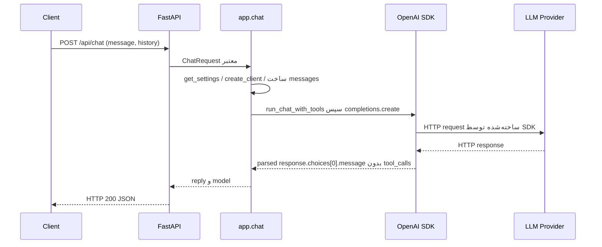
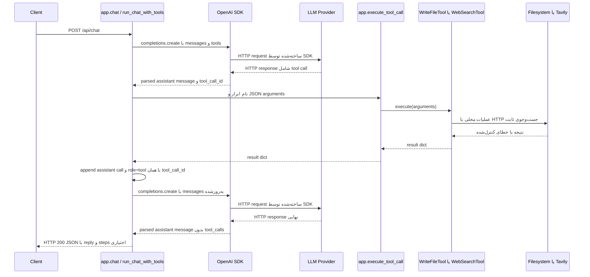

# گزارش معماری و جریان اجرای Backend

این گزارش بر اساس سورس فعلی پروژه در `D:\AI\python-ai` تهیه شده است. مقدار هیچ متغیری از `.env` خوانده یا در این سند درج نشده است. ابزارهای runtime فعلی فقط `write_file` و `web_search` هستند؛ پیاده‌سازی‌های `read_file` و `fetch_url` در backend فعال وجود ندارند.

## A — ساختار پروژه

```text
D:\AI\python-ai\
├── app.py
├── tools\
│   ├── __init__.py
│   ├── write_file.py
│   └── web_search.py
├── tests\
│   ├── __init__.py
│   ├── test_app_routes.py
│   └── test_web_search.py
└── requirements.txt
```

- `app.py`: entry point برنامه؛ بارگذاری تنظیمات، ساخت client، مدل درخواست، prompt، routeها، ساخت history و حلقه‌ی Tool Calling را نگه می‌دارد. کلاس‌های ابزار را از فایل‌های خودشان import می‌کند.
- `tools/__init__.py`: exportهای ساده‌ی `WebSearchTool` و `WriteFileTool` را فراهم می‌کند. `app.py` فعلی کلاس‌ها را مستقیم از ماژول‌هایشان import می‌کند.
- `tools/write_file.py`: تعریف `WriteFileTool`، schema مربوط به `write_file`، بررسی مسیر و نوشتن امن داخل workspace.
- `tools/web_search.py`: تعریف `WebSearchTool` و استثنای `SearchProblem`، schema مربوط به جست‌وجو، اعتبارسنجی query و تعداد نتیجه، فراخوانی Tavily و محدودسازی خروجی.
- `tests/test_app_routes.py`: تست routeها، تنظیمات، پاسخ‌های چت و رفتار `WriteFileTool`.
- `tests/test_web_search.py`: تست `WebSearchTool`، transport، schema، خطاها و اتصال نتیجه‌ی ابزار به Tool Calling loop.
- `requirements.txt`: وابستگی‌های Python مورد استفاده‌ی پروژه.

`app_old_buffer_recovery.txt` و `_tmp_remove_ranges.py` فایل‌های runtime این backend نیستند و از `app.py` import نمی‌شوند.

## B — کلاس‌ها و توابع

### `ChatRequest` — در `app.py`

کلاس Pydantic برای اعتبارسنجی body مربوط به `POST /api/chat` است:

- `message: str` با مقدار پیش‌فرض `""`.
- `history: list[Any]` با `default_factory=list`.

فیلد انتخاب مدل در request وجود ندارد؛ مدل از تنظیمات server انتخاب می‌شود. هیچ state مکالمه‌ای داخل این کلاس ذخیره نمی‌شود.

### `WriteFileTool` — در `tools/write_file.py`

هر instance مسیر workspace خود را در `workspace_dir` نگه می‌دارد.

- `__init__(workspace_dir=None)`: مسیر workspace را از آرگومان می‌گیرد یا از مسیر پیش‌فرض پروژه می‌سازد.
- `ensure_workspace()`: پوشه‌ی workspace را در startup ایجاد می‌کند؛ خطای `OSError` را چاپ می‌کند و ادامه‌ی startup را متوقف نمی‌کند.
- `get_schema()`: schema سازگار با Function Calling برای نام `write_file` و فیلدهای `path`, `content`, `overwrite` می‌دهد.
- `execute(arguments, root=None)`: ورودی‌ها را بررسی می‌کند، مسیر را به workspace محدود می‌کند، اندازه و پسوند را کنترل می‌کند و فایل را می‌سازد یا جایگزین می‌کند. برای تست، `root` امکان استفاده از پوشه‌ی موقت را می‌دهد.
- `_remove_created_folders(folders)`: فقط پوشه‌های خالی‌ای را که همین عملیات ساخته و شکست خورده است حذف می‌کند.

این کلاس به filesystem دسترسی دارد، اما network call ندارد. ساخت فایل جدید با `O_EXCL` انجام می‌شود تا فایل موجود تصادفاً جایگزین نشود؛ جایگزینی فایل موجود با temporary file و `os.replace` انجام می‌شود.

نمونه‌ی ساخت و استفاده مطابق کد:

```python
write_file_tool = WriteFileTool()
result = write_file_tool.execute({"path": "notes.txt", "content": "text"})
```

### `SearchProblem` — در `tools/web_search.py`

یک `Exception` با فیلد `reason` است. `_post_json()` خطاهای network/provider را به این خطاهای محدود تبدیل می‌کند تا متن خام exception یا بدنه‌ی خطای provider به نتیجه‌ی ابزار نرسد. این کلاس خودِ ابزار نیست.

### `WebSearchTool` — در `tools/web_search.py`

تنظیمات ثابت ابزار به‌صورت class attribute نگه داشته شده‌اند، از جمله نام ابزار، نام env var کلید، endpoint ثابت Tavily، timeout، بازه‌ی نتیجه و سقف طول query/result.

- `get_schema()`: schema ابزار را می‌سازد. `query` لازم است و `max_results` اختیاری است؛ هیچ پارامتر URL ندارد.
- `execute(arguments, http_post=None)`: نوع و محتوای query و `max_results` را اعتبارسنجی می‌کند، کلید را هنگام اجرا از environment می‌خواند، payload و headers را می‌سازد، transport را فراخوانی می‌کند و پاسخ را محدود و به قالب نتیجه تبدیل می‌کند. `http_post` برای تست transport ساختگی است.
- `_post_json(url, payload, headers, timeout)`: درخواست HTTP POST را با `urllib.request` می‌فرستد؛ timeout و تبدیل امن خطاهای HTTP/URL را انجام می‌دهد.
- `_status_for_code(status_code)`: statusهای Tavily را به reasonهایی مثل `rate_limited`, `unauthorized` و `rejected` نگاشت می‌کند.
- `_failure(reason, query, message=None)`: شکل ثابت نتیجه‌ی خطا را می‌سازد.

نمونه‌ی ساخت و اجرای مطابق کد:

```python
web_search_tool = WebSearchTool()
result = web_search_tool.execute({"query": "latest release"})
```

`TAVILY_API_KEY` فقط در backend خوانده می‌شود و در header `Authorization` به Tavily می‌رود؛ مقدار آن به browser یا متن پاسخ منتقل نمی‌شود.

### کلاس‌های تست

کلاس‌های تست ابزار production نیستند و state موقت یا transport ساختگی فراهم می‌کنند:

- در `test_app_routes.py`: `ScriptedCompletions` پاسخ‌های مدل را به‌ترتیب برمی‌گرداند؛ `ModelConfigTests`, `EnvLoadingTests`, `SettingsTests`, `WriteFileToolTests`, `ConfigRouteTests`, `ChatRouteTests`, `SafetyTextTests`, `AppWiringTests` و `SingleFileTests` گروه‌های رفتاری را می‌آزمایند.
- در `test_web_search.py`: `FakeTransport` درخواست‌ها را ثبت و پاسخ/exception ساختگی می‌دهد؛ `FakeCompletions` و `LoopTestCase` برای آزمون loop و workspace موقت‌اند. گروه‌های دیگر query/result limits، خطاهای provider، schema، output size و `RealTransportTests` را بررسی می‌کنند. کلاس داخلی `FakeResponse` پاسخ HTTP ساختگی می‌سازد.

### توابع مهم بیرون از کلاس

- `load_env_file(path=None)` در `app.py`: خطوط ساده‌ی `KEY=VALUE` از `.env` را می‌خواند و با `os.environ.setdefault` متغیر موجود را بازنویسی نمی‌کند.
- `configured_model(environ=None)`: اول `DEEPSEEK`، سپس `MODEL_NAME` و در نهایت مقدار پیش‌فرض موجود در سورس را انتخاب می‌کند.
- `get_settings()`: `OPENAI_API_KEY` را لازم می‌داند و `BASE_URL` و model را به‌صورت dict می‌دهد.
- `create_client(settings)`: `OpenAI` را با API key، base URL، timeout و retry می‌سازد.
- `friendly_error(error)`: خطاهای شناخته‌شده‌ی SDK را به پیام عمومی و بدون متن خام exception تبدیل می‌کند.
- `execute_tool_call(name, raw_arguments, root=None)` در `app.py`: اسم ابزار را پیدا می‌کند، JSON را parse می‌کند، object بودن آرگومان را می‌سنجد و `execute()` همان instance را صدا می‌زند.
- `run_chat_with_tools(client, model, messages, tool_runner=None)`: حلقه‌ی درخواست به LLM، اجرای tool calls و بازگرداندن reply/steps را اداره می‌کند.

## C — FastAPI و REST API

### `GET /`

- Handler: `read_index()` در `app.py`.
- ورودی: body، query parameter یا path parameter تعریف نشده است.
- خروجی موفق: `FileResponse` برای `static/index.html`؛ status پیش‌فرض موفق FastAPI، یعنی 200.
- side effect برنامه‌ای: فایل HTML خوانده/ارسال می‌شود؛ tool یا LLM اجرا نمی‌شود.

### `GET /api/config`

- Handler: `read_config()`.
- ورودی: پارامتر یا body ندارد.
- ابتدا `get_settings()` اجرا می‌شود تا وجود تنظیمات backend بررسی شود؛ سپس `{"ok": true}` برمی‌گردد.
- موفقیت status پیش‌فرض 200 دارد. اگر `get_settings()` به‌دلیل نبود `OPENAI_API_KEY` exception بدهد، handler آن را خودش تبدیل نمی‌کند؛ پاسخ خطای framework معمولاً 500 است.
- کلید، مدل و `BASE_URL` در response افشا نمی‌شوند.

### `POST /api/chat`

- Handler: `chat(request: ChatRequest)`.
- body شامل `message` و `history` است. هر دو default دارند؛ `history` فهرست ورودی‌های نامحدود از نظر نوع در مدل است و بعداً در handler فیلتر می‌شود.
- FastAPI/Pydantic بدنه‌ی ناسازگار با مدل را پیش از handler اعتبارسنجی می‌کند؛ خطای validation استاندارد FastAPI معمولاً 422 است.
- `message` با `strip()` بررسی می‌شود؛ پیام خالی با `HTTPException(400)` رد می‌شود.
- موفقیت معمولاً `{"reply": ..., "model": ...}` است. اگر `steps` وجود داشته باشد، به response افزوده می‌شود. status موفق پیش‌فرض 200 است.
- exceptionهای داخل `run_chat_with_tools()` در `chat()` به `HTTPException(502)` با متن `friendly_error()` تبدیل می‌شوند. `get_settings()` و `create_client()` پیش از این `try` هستند؛ خطای آن‌ها توسط این handler به 502 تبدیل نمی‌شود و به رفتار خطای پیش‌فرض FastAPI می‌رسد.

### مفاهیم HTTP در همین برنامه

- **HTTP endpoint** آدرس و روش قابل‌دسترسی server است؛ برای نمونه `POST /api/chat`.
- **Handler** تابع Pythonای است که FastAPI به endpoint وصل کرده است؛ در اینجا `chat()`.
- **HTTP request** شامل method، URL، headers و در این endpoint body JSON است.
- **HTTP response** شامل status و body JSON یا فایل است.
- **REST API contract** شکل توافق‌شده‌ی request/response است. این پروژه JSON API با routeهای مشخص است؛ از روی همین routeها نمی‌توان ادعا کرد همه‌ی اصول REST resource modeling را پیاده کرده است.

## D — چرخه‌ی کامل پرسش و پاسخ

درخواست عادی، بدون tool call:

1. Client به `POST /api/chat` با `message` و احتمالاً `history` درخواست می‌فرستد.
2. FastAPI بدنه را به `ChatRequest` تبدیل و validate می‌کند.
3. `chat()` پیام را trim و خالی بودنش را بررسی می‌کند.
4. `get_settings()` تنظیم server را می‌خواند و `create_client()` یک OpenAI-compatible client می‌سازد.
5. خود `chat()` آرایه‌ی `messages` را با system prompt، history معتبر و پیام جدید می‌سازد.
6. `chat()`، `run_chat_with_tools(client, model, messages)` را اجرا می‌کند.
7. `run_chat_with_tools()`، `client.chat.completions.create(...)` را صدا می‌زند.
8. SDK پاسخ provider را به objectهای Python تبدیل می‌کند؛ برنامه `response.choices[0].message` را می‌خواند.
9. اگر `tool_calls` خالی باشد، `message.content` trim می‌شود و به `chat()` برمی‌گردد.
10. `chat()` آن را در response JSON می‌گذارد و FastAPI به Client می‌فرستد.

چرخه‌ی tool call در بخش F با جزئیات و نمودار آمده است.

## E — درخواست و پاسخ LLM

### ساخت client

`create_client(settings)` از `OpenAI(...)` استفاده می‌کند و پارامترهای زیر را می‌دهد:

- `api_key=settings["api_key"]` از `OPENAI_API_KEY`.
- `base_url=settings["base_url"]` از `BASE_URL`؛ اگر تنظیم نشده باشد، `None` به SDK می‌رسد.
- timeout ثابت 30 ثانیه و `max_retries=1`.
- `model=settings["model"]` در هر درخواست از تنظیم server می‌آید؛ client سازنده‌ی مدل نیست.

مدل از `DEEPSEEK`، سپس `MODEL_NAME` یا fallback داخل کد به دست می‌آید. هیچ انتخاب مدل از body چت گرفته نمی‌شود.

### پیام‌ها

`messages` یک list از dictهاست. شکل‌های اصلی:

```python
{"role": "system", "content": SYSTEM_PROMPT}
{"role": "user", "content": "..."}
{"role": "assistant", "content": "..."}
```

درخواست با tool call، یک پیام assistant دیگر شامل `tool_calls` هم دارد. نتیجه‌ی هر ابزار با شکل زیر به همان list افزوده می‌شود:

```python
{"role": "tool", "tool_call_id": "شناسه‌ی همان فراخوانی", "content": "JSON نتیجه"}
```

در دورهایی که ابزار مجاز است، SDK call شامل `model`, `messages`, `tools=TOOLS` و `tool_choice="auto"` است. پس از محدودیت دور ابزار یا عدم پشتیبانی، call فقط `model` و `messages` می‌فرستد.

`client.chat.completions.create(...)` متد Python SDK است، نه خودِ شیء‌ی HTTP response. SDK درخواست HTTP provider را می‌فرستد و پاسخ HTTP را parse می‌کند؛ کد این پروژه با object حاصل کار می‌کند. از `response.choices[0].message`، `message.content` و `message.tool_calls` استفاده می‌شود. `finish_reason` در کد خوانده نمی‌شود؛ تصمیم tool/final با وجود یا نبود `tool_calls` گرفته می‌شود. `stream=True` یا پاسخ streaming در این call وجود ندارد.

## F — چرخه‌ی Tool Calling

1. در زمان import، `app.py` دو instance می‌سازد: `write_file_tool` و `web_search_tool`.
2. map `tools_by_name` نام schema را به instance وصل می‌کند.
3. `TOOLS` با فراخوانی `get_schema()` هر instance ساخته می‌شود و به SDK request داده می‌شود.
4. provider می‌تواند در `message.tool_calls` یک یا چند function call برگرداند. مدل فقط درخواست را پیشنهاد می‌دهد؛ اجرای کد را Python انجام می‌دهد.
5. `run_chat_with_tools()` پیام assistant و شناسه‌ها را به شکل dict قابل‌ارسال بازسازی و به `messages` اضافه می‌کند.
6. برای هر call، نام و `function.arguments` خوانده و `execute_tool_call()` صدا زده می‌شود.
7. `execute_tool_call()` نام را trim می‌کند، instance را پیدا می‌کند، رشته‌ی JSON را parse می‌کند و مطمئن می‌شود آرگومان‌ها dict هستند.
8. `tool.execute(arguments)` نتیجه‌ی همان ابزار را تولید می‌کند. نام ناشناخته یا JSON خراب به نتیجه‌ی خطای `ok: false` تبدیل می‌شود، نه اجرای دلخواه.
9. نتیجه با `json.dumps(..., ensure_ascii=False)` در پیام `role="tool"` قرار می‌گیرد؛ `tool_call_id` همان شناسه‌ی درخواست اصلی است تا provider بتواند دو پیام را تطبیق دهد.
10. حلقه دوباره `client.chat.completions.create(...)` را با `messages` به‌روز‌شده صدا می‌زند.
11. حداکثر 3 دور tool call و حداکثر 3 call در هر دور اجرا می‌شود. callهای اضافه در همان دور با `status="refused"` پاسخ می‌گیرند. پس از سقف دورها، ابزارها غیرفعال می‌شوند و مدل برای پاسخ نهایی فراخوانی می‌شود.
12. وقتی پاسخ دیگر `tool_calls` ندارد، reply برگردانده می‌شود.

**Schema در برابر implementation:** schema فقط نام و پارامترهایی را که به LLM معرفی می‌شوند تعریف می‌کند؛ کد Python در کلاس ابزار نوع‌ها، مقادیر و اثر واقعی را کنترل می‌کند. schema به‌تنهایی کد اجرا نمی‌کند.

## G — کلاس‌های ابزار

### `WriteFileTool`

- فایل: `tools/write_file.py`؛ نام schema: `write_file`.
- ورودی‌های schema: `path` و `content` لازم؛ `overwrite` اختیاری و boolean.
- `get_schema()` schema را می‌دهد؛ `execute(arguments, root=None)` اجرای ابزار است؛ `ensure_workspace()` پوشه‌ی workspace را هنگام import/startup آماده می‌کند؛ `_remove_created_folders()` cleanup محدود انجام می‌دهد.
- مسیر باید relative، کوتاه و مجاز باشد. مسیر absolute، drive/UNC، `..`، hidden segment، نام حساس، پوشه‌های ممنوع، پسوندهای ممنوع و پسوند خارج از allowlist رد می‌شوند.
- `resolve` مسیر موجود یا نزدیک‌ترین parent را بررسی می‌کند تا مسیر از root خارج نشود؛ symlink هدف و parent مستقیم رد می‌شوند.
- محتوا به 200 KiB محدود است. فایل جدید با `O_EXCL` ساخته می‌شود و replace با temporary file و `os.replace` انجام می‌شود.
- موفقیت شامل `ok`, `path`, `bytes`, `characters`, `created`, `overwritten`, `summary` است؛ شکست شامل `ok: false` و `error`.

### `WebSearchTool`

- فایل: `tools/web_search.py`؛ نام schema: `web_search`.
- ورودی لازم `query` و ورودی اختیاری `max_results` با بازه‌ی 1 تا 8 است؛ schema پارامتر URL ندارد.
- `get_schema()` تعریف function را می‌دهد؛ `execute(arguments, http_post=None)` اعتبارسنجی و جریان جست‌وجو را انجام می‌دهد.
- Query باید رشته‌ی غیرخالی، پس از normalize حداکثر 400 نویسه باشد. `max_results` باید integer باشد؛ bool نیز عمداً رد می‌شود.
- کلید `TAVILY_API_KEY` فقط هنگام اجرا از environment خوانده می‌شود. درخواست به endpoint ثابت Tavily می‌رود.
- پاسخ نتایج را به تعداد خواسته‌شده، title حداکثر 200، URL حداکثر 300، snippet حداکثر 600 و مجموع متن excerpt حداکثر 3000 نویسه محدود می‌کند.
- نتیجه‌ی موفق شامل `ok`, `status`, `query`, `count`, `results`, `truncated`, `summary`, `note` است. نبود نتیجه یا خطا با object ساختاریافته‌ی `ok: false` بازمی‌گردد.
- `SearchProblem` در همین فایل reasonهای کنترل‌شده‌ی خطا را حمل می‌کند. `_post_json()` تنها بخش network است؛ `_status_for_code()` نگاشت status، و `_failure()` ساخت پاسخ خطاست.

`web_search` URL نتیجه را باز نمی‌کند؛ URLها صرفاً داده‌ی result هستند. بنابراین مسیر SSRF-fetch در ابزار فعلی وجود ندارد و ابزار `fetch_url` نیز ثبت نشده است.

**افزودن ابزار جدید طبق همین ساختار:** یک کلاس در فایل مستقل بسازید که schema و `execute()` داشته باشد؛ instance را در `app.py` بسازید، نامش را در `tools_by_name` قرار دهید تا schema آن وارد `TOOLS` و dispatch آن در دسترس شود. در source فعلی registry سراسری جداگانه یا inheritance وجود ندارد.

## H — نمودارهای Sequence

### پاسخ نهایی بدون ابزار



### یک tool call و پاسخ نهایی



در مسیر `write_file`، participant مربوط به `X` filesystem محلی است و HTTP call وجود ندارد. در مسیر `web_search`، HTTP فقط به endpoint ثابت جست‌وجو می‌رود.

## I — جریان داده و رابطه‌ی objectها

- پیام تازه ابتدا در `ChatRequest.message` قرار می‌گیرد؛ پس از trim در `chat()` به `messages` افزوده می‌شود.
- `ChatRequest.history` از client می‌آید؛ فقط 40 ورودی آخر بررسی می‌شوند. تنها dictهایی که `role` آن‌ها `user` یا `assistant` و `content` آن‌ها پس از تبدیل به string و trim غیرخالی باشد وارد `messages` می‌شوند.
- `messages` در هر درخواست جدید ساخته می‌شود؛ server آن را در database یا متغیر پایدار نگه نمی‌دارد. در این پیاده‌سازی history فقط از request جاری می‌آید.
- هر `chat()` یک settings dict، یک OpenAI client و یک messages list می‌سازد. دو instance ابزار در سطح module ساخته شده‌اند و بین درخواست‌ها استفاده می‌شوند.
- پاسخ LLM object SDK است؛ پیام assistant با tool calls به dict تبدیل می‌شود. نتیجه‌ی tool به JSON string در `content` پیام tool می‌رود.
- `run_chat_with_tools()` در صورت نیاز stepهای خلاصه‌شده را نیز برمی‌گرداند؛ `chat()` آن را به `steps` در HTTP response تبدیل می‌کند.

## J — خطاها و امنیت

### کنترل‌های موجود

- Pydantic `ChatRequest` شکل کلی body را validate می‌کند؛ پیام خالی با 400 رد می‌شود.
- خطاهای مسیر و نوشتن در `WriteFileTool` به `ok: false` تبدیل می‌شوند؛ مسیر workspace، پسوند، اندازه، traversal و symlink کنترل می‌شوند.
- `overwrite` فقط boolean پذیرفته می‌شود و به‌صورت پیش‌فرض جایگزینی فایل موجود ممنوع است.
- `execute_tool_call()` JSON خراب، آرگومان غیر-dict و نام ناشناخته را رد می‌کند.
- `WebSearchTool` query/result count را محدود می‌کند، timeout دارد، URL دلخواه از مدل نمی‌پذیرد، خطاهای provider را sanitize می‌کند و کلید را در header می‌گذارد.
- `friendly_error()` متن خام خطای SDK را به client برنمی‌گرداند.
- حلقه تعداد دورها و تعداد tool callها را محدود می‌کند.

### محدودیت‌ها و نکات قابل توجه

- `WebSearchTool._post_json()` پاسخ را با `response.read()` کامل در حافظه می‌خواند؛ سقف‌های نویسه/نتیجه پس از parse اعمال می‌شوند، نه هنگام stream دانلود body. بنابراین hard byte limit برای body پاسخ در سورس فعلی دیده نمی‌شود.
- `chat()` و `/api/config` خطاهای `get_settings()` را داخل `try` سفارشی نمی‌گیرند؛ برای نمونه نبود `OPENAI_API_KEY` به خطای پیش‌فرض FastAPI می‌رسد، نه پیام 502 تعریف‌شده برای خطاهای داخل حلقه.
- در `execute_tool_call()` نام برای lookup با `strip()` نرمال می‌شود، ولی تشخیص این‌که `root` را به ابزار بدهد با مقایسه‌ی نام خام انجام می‌شود. نام استاندارد schema مشکلی ندارد؛ نامی با فاصله‌ی اضافی ممکن است ابزار را پیدا کند ولی `root` آزمایشی به آن نرسد.
- در کد routeها authentication وابسته به کاربر تعریف نشده است. اجرای مستقیم `app.py` در انتهای فایل روی `127.0.0.1` bind می‌شود؛ اجرای Uvicorn با تنظیمات دیگر می‌تواند bind متفاوتی داشته باشد.
- API key در response routeها قرار نمی‌گیرد و `.env` در این تحلیل خوانده نشده است.

## K — وابستگی‌ها و تماس‌های بیرونی

| وابستگی | کاربرد واقعی در سورس |
|---|---|
| `fastapi` | ساخت `FastAPI`، routeها و `HTTPException` |
| `pydantic` | مدل request یعنی `ChatRequest` |
| `openai` | `OpenAI` و exceptionهای client؛ درخواست chat به provider |
| `uvicorn` | اجرای ASGI server در بلوک `__main__` |
| `urllib` | تماس HTTP مستقیم `WebSearchTool` با Tavily؛ کتابخانه‌ی standard library است |
| `pathlib`, `os`, `tempfile`, `json` | مسیرها، متغیرهای محیطی، نوشتن atomic و serialization |

`requirements.txt` همین چهار وابستگی third-party را pin کرده است. در تست‌ها transport و client ساختگی‌اند؛ source جست‌وجو نیز تماس واقعی به URLهای result نمی‌فرستد.

## L — راهنمای یادگیری

### ترتیب پیشنهادی مطالعه

1. `ChatRequest` و `chat()` در `app.py`: شکل HTTP request، اعتبارسنجی و ساخت `messages` را ببینید.
2. `get_settings()` و `create_client()`: تنظیمات environment چگونه به OpenAI-compatible client می‌رسند.
3. `run_chat_with_tools()`: request، response، tool call، نتیجه و loop را دنبال کنید.
4. `execute_tool_call()`: ببینید نام و JSON arguments چگونه به instance انتخاب‌شده می‌رسند.
5. `tools/write_file.py` و `tools/web_search.py`: schema و اجرای واقعی هر ابزار را جدا بخوانید.
6. آزمون‌های `test_app_routes.py` و `test_web_search.py`: fake client/transport نشان می‌دهد بدون تماس واقعی network چطور رفتار آزموده می‌شود.

### اصطلاحات در همین backend

- **Class:** تعریف رفتار و داده؛ `WriteFileTool` نوع ابزار نوشتن است.
- **Instance:** شیء ساخته‌شده از class؛ `write_file_tool = WriteFileTool()` نمونه‌ای است که app ثبت می‌کند.
- **Method:** تابع وابسته به instance، مثل `write_file_tool.execute(...)`.
- **Function:** تابع مستقل، مثل `chat()` یا `execute_tool_call()`.
- **Module / import:** فایل Python یک module است؛ `app.py` کلاس را با `from tools.write_file import WriteFileTool` وارد می‌کند.
- **FastAPI route:** اتصال method/path HTTP به handler Python؛ `@app.post("/api/chat")` تابع `chat` را ثبت می‌کند.
- **REST API:** قرارداد ارتباط HTTP؛ این پروژه endpointهای JSON دارد، اما routeها را دقیق‌تر می‌توان HTTP API نامید تا ادعای REST کامل.
- **Request / response:** داده‌ی ورودی و خروجی HTTP؛ response چت شامل `reply`, `model` و گاهی `steps` است.
- **LLM client:** wrapper SDK که call Python را به درخواست provider تبدیل می‌کند و پاسخ HTTP را به object Python parse می‌کند.
- **Message history:** ورودی `history` از client در هر request؛ backend فقط آن را فیلتر می‌کند و ذخیره‌ی پایدار ندارد.
- **Tool schema:** قرارداد JSON که به مدل می‌گوید ابزار چه نام/پارامتری دارد.
- **Tool Calling:** مدل یک function call پیشنهاد می‌دهد؛ Python نام و آرگومان را بررسی و اجرا می‌کند.
- **Dispatcher:** `execute_tool_call()` که نام را به instance متناظر وصل می‌کند.
- **`tool_call_id`:** شناسه‌ی یکتای call؛ همان شناسه در پیام `role="tool"` برمی‌گردد تا provider نتیجه را به call درست وصل کند.
- **`while`:** حلقه‌ی `run_chat_with_tools()` درخواست‌های مدل و roundهای ابزار را تکرار می‌کند.
- **`async` / `await`:** در backend فعال استفاده نشده؛ routeها و SDK callهای این سورس synchronous هستند.

### ردگیری خلاصه‌ی کامل

1. Client → `POST /api/chat` → FastAPI → `chat(ChatRequest)`.
2. `chat()` → `get_settings()` → `create_client()` → ساخت `messages`.
3. `chat()` → `run_chat_with_tools()` → `client.chat.completions.create(...)`.
4. اگر `tool_calls` وجود داشته باشد: `execute_tool_call()` → instance `execute()`.
5. app پیام assistant و نتیجه‌ی `role="tool"` با همان `tool_call_id` را به `messages` اضافه می‌کند.
6. حلقه دوباره LLM را صدا می‌کند؛ در نبود tool call، reply به `chat()` برمی‌گردد.
7. `chat()` → response JSON → FastAPI → Client.

**وضعیت بررسی:** این سند با خواندن سورس و تست‌ها تهیه شد؛ suite یا toolهای واقعی عمداً اجرا نشدند تا تحلیل فقط خواندنی بماند. مقدار `.env` بررسی یا درج نشده است.
